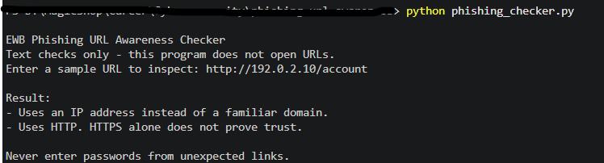
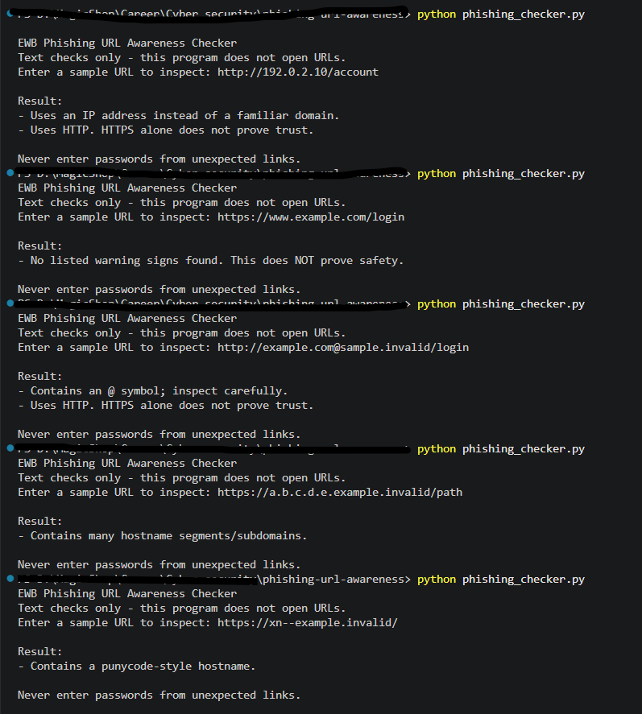

# EWB Phishing URL Awareness Checker

## Overview

Phishing is a form of the Social Engineering cyber attack that lures victims into providing sensitive information or downloading malware by clicking on links sent through emails (most often). This tool aims to analyse the URLs found in such Phishing emails to thwart off such phishing attempts on the victims and keep them safe. This tools only analyses URLs; it does not interact with them.

## Features

- Detects an @ symbol in the URL
- Flags unusually long URLs (over 100 characters)
- Flags IP-address hostnames
- Flags many hostname segments (5 or more)
- Flags punycode-style hostnames (xn--)
- Flags the HTTP scheme
- Malformed input is handled with an error message
- Program loops forever for checking different URLs until either of the following are entered: 'q', "quit", "exit"

## Requirements

Python 3.10 or later. No extra packages.

## How to Run

Windows: python phishing_checker.py
Mac/Linux: python3 phishing_checker.py

## Example Output

Entering  "http://192.0.2.10/account" produces the following output:
 Uses an IP address instead of a familiar domain.

## Testing

| # | Input | Expected result | Actual result | Pass/Fail |
| --- | ------- | ----------------- | --------------- | ----------- |
| 1 | https://www.example.com/login | No listed warning signs | No listed warning signs found. This does NOT prove safety | Pass |
| 2 | http://192.0.2.10/account | IP address + HTTP | 1. Uses an IP address instead of a familiar domain. 2. Uses HTTP. HTTPS alone does not prove trust. | Pass |
| 3 | http://example.com@sample.invalid/login | @ symbol + HTTP | 1. Contains an @ symbol; inspect carefully. 2. Uses HTTP. HTTPS alone does not prove trust. | Pass |
| 4 | https://a.b.c.d.e.example.invalid/path | Many hostname segments | Contains many hostname segments/subdomains | Pass |
| 5 | https://xn--example.invalid/ | Punycode-style hostname | Contains a punycode-style hostname | Pass |

## Screenshots

## Improvements

1. Stop crashes on malformed input - Earlier version of the program crashed when an invalid URL was entered while the newer version of the program informs the user with an error message prompting the invalidity of the entered URL. This was handled by using try-except blocks to catch the ValueError thrown by the invalid input. Now, entering an invalid URL produces the error message without crashing the program.
2. Loop with quit - Earlier version of the program used to stop after examining each input URL, while the newer version of the program keeps running for examining subsequent input URLs until the user types either 'q', "quit", or "exit". This was handled by introducing a while True loop inside the main() function that breaks only when the before mentioned words are input by the user in place of an URL. This can be tested by entering either of the said words as input, upon which a farewell message is displayed followed by the stopping of the program.

## Limitations

This is an educational tool. It only reads URL text. It does not visit URLs, scan for malware or prove that a URL is safe. No warning signs found does NOT mean a URL is safe.

## Ethical Use

Use sample strings only. Do not collect credentials. Do not use this project to deceive anyone or to test websites without permission.

## Author

Druti Bose, EWB AI-Powered Cybersecurity Internship Course, EWB Courses
